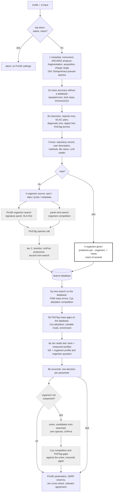
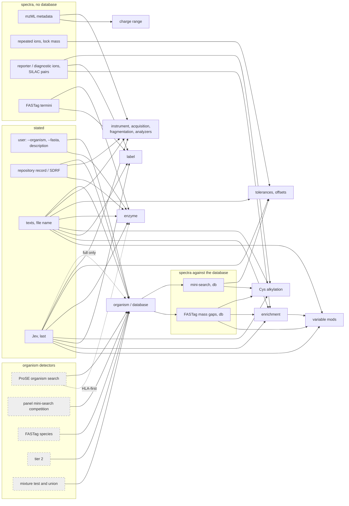

# Decision flow (prose-auto 0.1.9)

prose-auto has two modes:
- **Full mode (the default)** infers the organism and the search database from the spectra and the texts.
- **Fast mode (`--fast` with `--organism` and/or `--fasta`)** takes the given organisms as true. It runs every other
  detector against their proteome, or against the union of their proteomes when several are given.

Both modes decide the parameters in the same order:
1. **What the file is:** top-down check, then instrument, analyzers, fragmentation, acquisition and charge range.
2. **What needs no database:** mass accuracy, chemistry and the tag termini.
3. **What is stated:** repository records, the user's description, methods sections, the file name.
4. **The organism and the search database.** Only this step differs between the modes.
5. **What needs the database:** the mini-search (mass accuracy, Cys alkylation) and the FASTag mass gaps.
6. **The readers and reconciling:** Jev reads last, then reconcile decides each parameter.

In full mode, a suspected organism mixture adds two more steps after reconciling: the union search, then the
database-dependent steps run again against the union.

## Order of the stages

Grey dashed boxes run in full mode only. Fast mode replaces them with the "organism given" box.

## Which detectors feed which decision

An edge means that the detector gives evidence for that parameter. Grey dashed detectors run in full mode only.
Detectors marked "db" need the search database, so in fast mode they run against the given proteome.

## Per parameter

| Parameter | Evidence, in decision order | Fast mode |
|---|---|---|
| organism, search database | user, record, texts, then the organism source: the ProSE organism search when nothing is stated, else the panel mini-search with the FASTag species call and tier 2; Jev's organism answer; after reconciling, the mixture test and the union (3 organisms at most) | given; no detector runs; several organisms are one union |
| instrument, analyzers, fragmentation, acquisition | mzML metadata (Bruker `analysis.tdf`) first, then the record, the texts and Jev | unchanged |
| charge range | precursor charges up to 9 kDa (DIA: the pseudo-spectra), clamped to 1–20 | unchanged |
| precursor / fragment tolerance and offset | database-free measurement (repeated ions, lock mass, immonium/y1), then the mini-search PSM errors on the database; texts and Jev only as coarse windows | mini-search on the given proteome |
| enzyme | user and record first; then the FASTag tag-termini call (margin ≥ 0.15; on timsTOF the K/R and residue shares of the tag ends and the mini-search protease competition) or Jev (p ≥ 0.8), the more confident one; then keywords. In full mode, the ProSE organism search (HLA-first) also decides when nothing else does | no ProSE organism search |
| Cys alkylation | diagnostic ions (weak), the mini-search competition (CAM / none / others) on the database, the FASTag mass gaps on the database, texts, Jev | competition and gaps on the given proteome |
| label | reporter ions, SILAC pairs, FASTag N-terminal gaps, texts, Jev | unchanged |
| enrichment | diagnostic ions, FASTag mass-gap combinations on the database, texts, Jev | gaps on the given proteome |
| variable mods | FASTag mass-gap combinations on the database, texts, Jev, implied by the enrichment | gaps on the given proteome |

The mini-search decides the protease only on timsTOF, where the tag-profile call fails (MS2 scans start above y1 of K
and R). Elsewhere its protease competition lost to the tag termini on tryptic and HLA runs and is not called.
