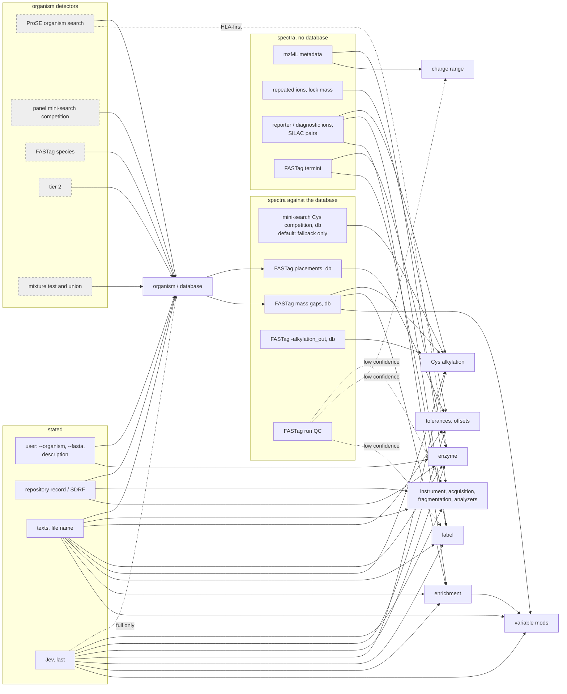

# Decision flow (prose-auto 0.1.11)

prose-auto has two modes:
- **The default (organism given):** `--organism` and/or `--fasta` (both repeatable) are required. Every detector runs
  against their proteome, or against the union of their proteomes when several are given. A database check warns
  when the given database does not fit the run.
- **`--infer-organism`** (the 0.1.10 full mode) infers the organism and the search database from the spectra and the
  texts.

Both modes decide the parameters in the same order:
1. **What the file is:** top-down check, then instrument, analyzers, fragmentation, acquisition and charge range.
2. **What needs no database:** mass accuracy, chemistry and the tag termini.
3. **What is stated:** repository records, the user's description, methods sections, the file name.
4. **The organism and the search database.** Only this step differs between the modes.
5. **What needs the database:**
   - default: one FASTag pass on the given database (placements, mass gaps, `-alkylation_out`,
     `-alkylation_tags_out`, `-qc_out`), the database check (one more FASTag pass on the check panel), and the
     mini-search only as a fallback (Cys when FASTag and the texts disagree or both abstain; timsTOF protease);
   - `--infer-organism`: the mini-search (organism and Cys competitions), the FASTag mass gaps and placements.
6. **The readers and reconciling:** Jev reads last (in the default mode its Cys answer can still start the
   fallback), then reconcile decides each parameter.

With `--infer-organism`, a suspected organism mixture adds two more steps after reconciling: the union search, then
the database-dependent steps run again against the union. After the search, `prose-auto check` tests the result
(below).

## Order of the stages

Grey dashed boxes run with `--infer-organism` only. The default replaces them with the "organism given" box and adds
the database check.

```mermaid
flowchart TD
    A[mzML / .d input] --> TD{top-down,<br/>native, intact?}
    TD -- yes --> STOP[abort: no ProSE settings]
    TD -- no --> M[1 metadata: instrument, MS1/MS2 analyzer,<br/>fragmentation, acquisition, charge range<br/>DIA: DIAspeXtract pseudo-spectra]
    M --> TOL[2a mass accuracy without a database:<br/>repeated ions, lock mass, immonium/y1]
    TOL --> CH[2b chemistry: reporter ions, SILAC pairs,<br/>diagnostic ions, digest hint, FASTag termini]
    CH --> TX[3 texts: repository record, user description,<br/>methods, file name, LLM reader]
    TX --> MODE{--infer-organism?}
    MODE -- yes --> SRC[4 organism source: auto / data / prose / metadata]
    SRC --> PO[ProSE organism search<br/>signature panel, HLA-first]:::full
    SRC --> PM[panel mini-search<br/>organism competition]:::full
    PO --> FS[FASTag species call]:::full
    PM --> FS
    FS --> T2[tier 2: shortlist, UniProt proteomes,<br/>second mini-search]:::full
    MODE -- no --> GIV[4 organism given:<br/>proteome per --organism, + --fasta,<br/>union of several]:::fast
    T2 --> DB[(search database)]
    GIV --> DB
    DB --> GAP[5a FASTag pass on the database:<br/>placements, mass errors, mass gaps,<br/>Cys calls, run QC]
    GAP --> CHK[5b database check:<br/>placements on human, mouse, yeast,<br/>E. coli, cRAP]:::fast
    CHK --> MS[5c mini-search fallback: Cys competition<br/>if FASTag and texts disagree or abstain;<br/>timsTOF protease without a tag call]
    MS --> JEV[6a Jev reads last: texts + measured profiles<br/>full: + organism profile and organism question]
    JEV --> REC[6b reconcile: one decision per parameter<br/>default: Cys fallback once more after Jev]
    REC --> MIX{organism mix<br/>suspected?}:::full
    MIX -- yes --> UN[union: candidates mini-searched,<br/>own spectra, UniProt]:::full
    UN --> REDO[Cys competition, FASTag gaps and placements<br/>against the union, reconcile again]:::full
    MIX -- no --> OUT
    REDO --> OUT
    REC -- fast --> OUT[ProSE parameters, SDRF columns,<br/>Jev cross-check, indicator agreement]
    classDef full fill:#eeeeee,stroke:#888888,stroke-dasharray: 5 5
    classDef fast fill:#ffffff,stroke:#000000,stroke-width:2px
```

## Which detectors feed which decision

An edge means that the detector gives evidence for that parameter. Grey dashed detectors run in full mode only.
Detectors marked "db" need the search database, so in the default mode they run against the given proteome.

## Per parameter

| Parameter | Evidence, in decision order | Default (organism given) |
|---|---|---|
| organism, search database | user, record, texts, then the organism source: the ProSE organism search when nothing is stated, else the panel mini-search with the FASTag species call and tier 2; Jev's organism answer; after reconciling, the mixture test and the union (3 organisms at most) | given; no detector runs; several organisms are one union |
| instrument, analyzers, fragmentation, acquisition | mzML metadata (Bruker `analysis.tdf`) first, then the record, the texts and Jev | FASTag QC analyser class as low-confidence metadata (a disagreement shows as a conflict) |
| charge range | precursor charges up to 9 kDa (DIA: the pseudo-spectra), clamped to 1–20 | unchanged |
| precursor / fragment tolerance and offset | database-free measurement (repeated ions, lock mass, immonium/y1), then the mass errors of the FASTag placements on the database; texts and Jev only as coarse windows | placements on the given proteome |
| enzyme | user and record first; then the FASTag tag-termini call (margin ≥ 0.15; on timsTOF the K/R and residue shares of the tag ends, with fewer than 175 tag ends the mini-search protease competition) or Jev (p ≥ 0.8), the more confident one; then keywords. In full mode, the ProSE organism search (HLA-first) also decides when nothing else does | no ProSE organism search |
| Cys alkylation | diagnostic ions (weak), the mini-search competition (CAM / none / others) on the database, the FASTag mass gaps on the database, texts, Jev | FASTag `-alkylation_out` (a database result like the competition, 0.86) and `-alkylation_tags_out` (0.6), the gaps, texts, Jev; the competition only as the fallback |
| label | reporter ions, SILAC pairs, FASTag N-terminal gaps, texts, Jev | plus FASTag QC reporter kits (0.35); the label becomes a fixed modification of the FASTag pass |
| enrichment | diagnostic ions, FASTag mass-gap combinations on the database, texts, Jev | gaps on the given proteome |
| variable mods | FASTag mass-gap combinations on the database, texts, Jev, implied by the enrichment | gaps on the given proteome |

Since 0.1.10 the mini-search chooses the organism (full mode) and runs the Cys alkylation competition (both modes);
its mass errors are replaced by those of the FASTag placements. It decides the protease only on timsTOF when the tag
ends give no call (fewer than 175; the tag-profile call fails there because the MS2 scans start above y1 of K and R).
Without the Cys competition the SDRF Cys score rose by 2 of 132 runs, but the runs whose decision changed lost 9.5 %
of their ProSE PSMs.

## Database checks (0.1.11)

| Check | When | Signal | Verdict |
|---|---|---|---|
| database check | default mode, before the search | share of the confident-tag spectra (E ≤ 1e-4) placed on the given database with an agreeing flank; per panel member (human, mouse, yeast, E. coli, cRAP) the share it places and the given database does not | warning below 5 %, or a member with ≥ 3 % and ≥ a tenth of the given share; `--check-organism strict` then infers the organism |
| `prose-auto check` | after the search | share of the confident-tag spectra identified; where the unidentified ones place | ok (≥ 15 % identified), settings likely wrong (≥ 20 % of the unidentified place on the given database), else database likely wrong or incomplete |
